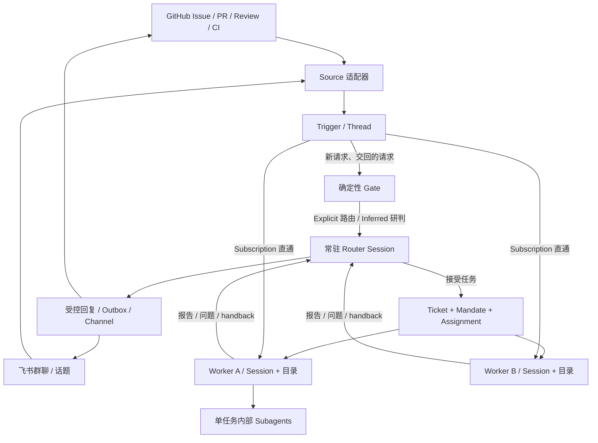
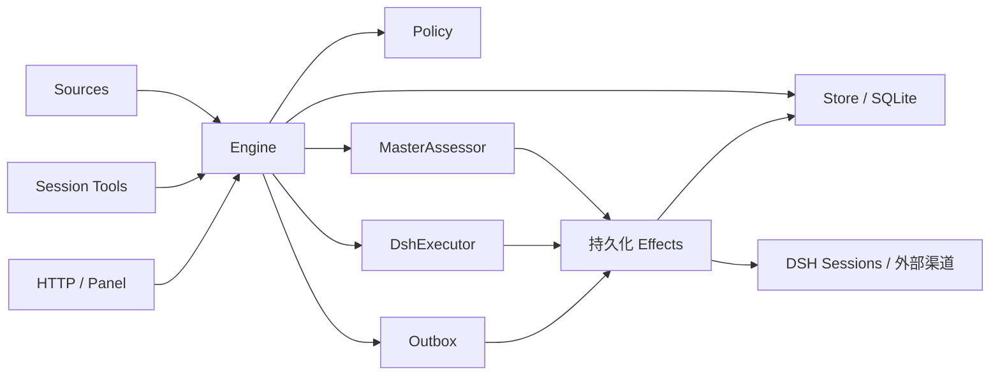

# DeepSeek Super-agent 架构调研

## 1. 调研对象与结论

调研对象是 DeepSeek Harness 团队于 **2026 年 10 月 31 日**公开的 [`deepseek-ai/dsh-superagent-prototype`](https://github.com/deepseek-ai/dsh-superagent-prototype)。GitHub API 显示仓库创建于当天 09:32:46 UTC，首次提交为当天 12:05:39 UTC；本次源码基线为：

```text
6337fc823ce20251c8de8085948165c81aaa701e
feat: add the dsh-superagent research prototype
```

项目使用 MIT 许可证，包版本为 `0.1.0`。它是运行在 DeepSeek Harness 上、面向**单个 GitHub 仓库、可选接入飞书**的主动式编程智能体研究原型。[1]

**核心判断：Super-agent 把“持续接收事件、决定哪些事情值得做、并行推进工单、让人参与关键决策”做成一个有持久状态的系统。模型负责语义判断和执行，确定性程序负责路由、准入、状态转换、重试和审计。**

这套设计针对的瓶颈是人的注意力：用户不必维护多个 Session 的上下文，也不必不断转发评审意见、CI 结果和群聊补充信息。

调研结合设计长文、官方文档、核心源码及测试用例阅读。未部署 GitHub/飞书账号，未运行上游测试，也未复现文章实验。设计长文的微信入口触发验证码、知乎入口返回 403，正文通过注明转载自 DeepSeek 知乎账号的全文副本阅读。[2][3]

## 2. 三个层次：Harness、Super-agent 设计、开源原型

| 层次 | 作用 |
| --- | --- |
| DeepSeek Harness | 基于 Cordis 的插件化 Agent 运行底座，提供模型调用、Session、工具、后台任务、子智能体、持久化和 Web UI |
| Super-agent 设计 | 持续在线、多任务并发、事件驱动的人机协作架构，覆盖云端执行调度、边缘环境和 Watchdog 等方向 |
| dsh-superagent-prototype | 上述设计的一条具体落地路径：DSH bundle + GitHub/飞书 Source + 工单引擎 + 本地 SQLite + 管理面板 |

原型通过 `cordis.patch.yml` 装配主插件、GitHub Source、默认关闭的飞书 Source，以及 Router/Worker 两种 Agent preset。它复用 Harness 的 Agent Loop，而不是另写一套模型运行时。[1][4]

## 3. 总体架构

### 3.1 逻辑上的 Router / Worker 双层结构



- **Router** 负责新任务分派、跨任务协调、准入研判及对外沟通，避免介入实现细节。
- **Worker** 聚焦一个 Ticket，拥有自己的上下文和工作目录，完成调查、实现、验证及交付。
- Worker 内部可以再创建 Subagent；这属于单个任务内部的协作，不改变上层分工。
- 后续消息通过订阅直接送达 Worker，Router 接收必要通知，但不再逐条调用转发工具。

因此，这一架构的重点是**多个长期任务的持续协调**。一般 Agent Team 更侧重一个复杂任务内部的拆解和成员协作；这里把这部分工作留在 Worker 内部。[2][5]

原型中的 Router 仍有 `bash`、`read` 等工具；“不亲自执行技术工作”主要通过角色提示词及精简工具集落实。设计文章讨论的“Router 甚至不需要 Bash”不是本次代码的实际配置。

### 3.2 实现上的领域引擎与适配器



我的架构归类是：**事件驱动的领域状态机 + 端口/适配器结构 + 持久化副作用队列 + LLM 路由和执行会话**。

`Runtime` 是组合根，负责构造依赖、启动和关闭；`Engine` 是业务规则入口，负责事务和领域对象。领域层不直接访问 GitHub、飞书或模型 API。[6]

## 4. 五项关键设计

### 4.1 双层分工：把“保持连续”与“执行任务”分开

常驻 Router 维持跨渠道的关联；多个 Worker 并发执行，避免一个长命令阻塞整个团队。

原型为每个 Ticket 使用 `worker-<ticket id>` Session 和独立目录。目录可由 `prepare` 命令建立 Git worktree；没有配置 prepare 时，从空目录开始。重试会创建新 Assignment，但通常复用同一个 Session、目录、分支及 PR。

默认并发是 **3 个 Worker 槽位**，另外允许一个由人工消息或状态请求使用的额外槽位。唤醒已有工作优先于启动新工作，让队列积压时人仍能介入。[7]

### 4.2 事件驱动：过滤与路由都分成快慢两条路径

**准入的两层判断：**

1. **Gate：确定性快路径。** 根据来源、接收范围、允许名单、机器人名单、是否明确提及 Agent、准入表判断是否成为候选及其授权强度。
2. **Assessment：语义慢路径。** 对推断候选，Router 结合上下文判断是否匹配团队书面规则、是否存在明确实施意图、目标是否确定。

Explicit 请求直接走路由工具；Inferred 候选如需接受，必须经过完整研判。与所有规则明显无关的候选可从卡片直接忽略。

主动接单有三种模式：

| 模式 | 对推断候选的处理 |
| --- | --- |
| `off` | 不进入主动接单候选 |
| `observe`，默认 | 研判后记录“would accept”，不创建工单 |
| `auto` | 研判通过后创建工单 |

明确授权的请求在三个模式下都能工作。全局暂停是另一个设置。

`assessmentOutcome()` 要求每个启用规则恰好有一个判断，接受还需匹配规则、方向确定及意图证据。默认主动规则偏窄，主要是文案修正和目标明确的局部视觉修正。[8]

**路由的两条路径：**

- 新工作：Trigger → Eval → Router → Ticket。
- 已有工作：Trigger → Subscription → Ticket Input → Worker。

订阅是多对多关系。一个 Ticket 可同时订阅群聊、Issue 和 PR；同一个 Thread 也可被多个 Ticket 订阅。

人工跟进被 Worker 持有时，Router 不能再把它重复接成新工单；Worker 处理范围内的请求，范围外的请求通过 `handback` 交回。只有全部持有者释放后才重新进入 Eval。仅用于上下文的订阅不授予跟进权限，也不唤醒已结束工单。[5][8]

### 4.3 上下文：Inline & Spill，以及链式召回

系统将上下文窗口当作容量有限的缓存：

- **Inline**：直接提供当前任务高概率需要的消息、摘要和关联 ID。
- **Spill**：长文本留在窗口外，保留可继续读取的指针。
- **Chain of Recall**：沿对象引用逐步展开，例如 Trigger → Thread → Ticket → Assignment / Transcript → 相关 Thread。

原型中的具体实现：

- 研判 Trigger 正文上限 4,000 字符。
- 初始 Thread 窗口包含前 5 条消息，以及 Trigger 前后各 5 条。
- 最近两侧消息上限 1,200 字符，其他窗口消息 400 字符；其他已加载消息只提供 50 字符预览。
- 相关 Ticket 首次最多展示 8 个，优先显示未结束的。
- 通过 `orchestrator_eval_read` 和 `orchestrator_read` 继续读取。

这是基于业务对象 ID、引用和分页的按需召回；原型中没有独立向量检索或跨月记忆整合模块。文章也将长程记忆列为开放问题。[2][9]

### 4.4 异步和低打扰交互

设计文章提出异步 ReAct：将长工具调用从同步 `run()` 改为 `start()` / `stop()`，启动后立即返回，结果作为新事件进入会话。

原型通过 Harness 后台任务、inbox 和 preset 落地相应机制：

- Router/Worker 的前台 shell 最多等待 5 秒，之后转为后台任务。
- 新消息可以在后续推理步被接收。
- 后台工作仍在运行时，Worker 继续占用并发槽位，不会被误判为闲置。
- 交付或请求人工介入时释放槽位；子智能体停止，供人工评审的服务进程可以继续保留。
- Router 有 `noWait` 检查，拒绝部分阻塞式等待行为。

交互原则是：接单确认一次，工作期间保持安静，在可交付、需要决策或无法完成时发消息。IM 回复默认简短，飞书回复有 100 词硬限制；GitHub PR 则承担完整背景、改动及验证证据。

人工问题使用结构化 `human_action` 字段，而不是让系统从长报告里猜测是否需要人。[7][10]

### 4.5 持久运行：当前的恢复机制与更广的设计方向

**原型已经实现：**

- 本地 SQLite 保存领域状态及副作用队列。
- DSH 保存 Session 历史。
- 输入、启动、候选投递、报告转发及回复支持持久化重试。
- 进程重启恢复 Assignment，补投尚未进入会话历史的输入。
- HealthBoard 显示系统故障；连续失败才升级为需关注的问题。

**设计文章进一步提出：**

1. Agent Loop 运行在云端无状态计算容器中。
2. Session 等状态存放到独立数据库。
3. 执行环境保留在用户设备或托管机器，通过无会话状态的 daemon 连接，即 BYOM。
4. 外部 Watchdog Session 定期检查基础设施和 Worker 的实际进展，必要时干预或修正提示词。

本次原型没有这套云端/边缘执行协议，也没有独立 Watchdog Session。其 `Passes`、`Effects`、重试和健康状态是程序级恢复机制，不承担模型式的“是否跑偏”判断。[2][6]

## 5. 领域模型：长期任务为什么需要这些对象

| 对象 | 责任 | 关键约束 |
| --- | --- | --- |
| Source | 外部事件来源及读取位置 | 屏蔽自身消息、记录游标、转换外部语义 |
| Trigger | 不可变事件 | 以 ID 去重和审计，重复接收不重复建单 |
| Thread | 一组连续事件 | 每个 Thread 同时最多一个 Eval |
| Eval / Decision | 对一批 Trigger 的判断及结果 | accept / stop / ignore / unavailable |
| Policy | 当前准入和主动工作规则 | 有版本，规则变化使进行中的 Eval 重新判断 |
| Mandate | 一个 Ticket 的授权依据及范围 | 记录授权强度、身份、规则和 Policy 版本 |
| Ticket | 可长期持续、恢复的工作单元 | 业务生命周期独立于模型会话 |
| Assignment | 某次执行绑定 | pending → running → ended，可多次更换 |
| Subscription | Thread 与 Ticket 的关系 | 持续投递上下文，不扩大 Mandate |
| Channel / Outbox | 回复地址与发送记录 | 回到原始讨论，支持幂等、顺序和重试 |

**最有价值的分离是 Ticket、Mandate、Assignment：**

- Ticket 回答“这件事是什么、是否完成”。
- Mandate 回答“为什么允许做、范围到哪里”。
- Assignment 回答“当前由谁执行、这一轮是否正常”。

Worker 退出、模型报错、PR 等待评审，都不自动等于业务任务结束。PR 类 Ticket 通常在所跟进的 PR 满足关闭/合并条件后结束；仅 `ready` 报告通常表示等待评审。

已结束但未被人工停止的 Ticket，可以由原 Thread 的人工跟进恢复；恢复前重新验证 Mandate。机器人和 CI 不会自动唤醒已结束 Ticket。

策略变更通知受影响的运行中 Ticket，而不是立即中断所有工作。若要立即停止指定工作，应显式停止 Ticket；全局暂停也不会打断已运行的模型 turn。[5][7][8]

## 6. 可靠性的核心：领域事务与外部副作用分离

### 6.1 同步 Engine + 单一写入者

`Engine` 方法是同步的，每条命令在事务内更新领域对象，并调用端口排入外部工作。实际网络 I/O、Agent 启动和消息发送在事务提交之后执行。

Engine 内部划分为：

```text
Intake       接收、过滤、关联、订阅扇出
Evals        批处理、准入、超时、Decision
Tickets      授权工作、订阅、输入、重试、恢复、结束
Assignments  执行状态、输入确认、报告
Replies      按用途生成受控回复
```

依赖使用窄接口和角色限定的 `Pick<Engine, ...>`。Source、管理面板、Router 和 Executor 分别获得所需能力。[6]

### 6.2 SQLite + Effects + Outbox

数据库为 `<stateDir>/orchestrator.sqlite`，启用 WAL 和 `synchronous=FULL`。Runtime 在打开数据库前锁定状态目录，避免同一状态目录被多个实例同时写入。

主要表：

```text
trigger / disposition / trigger_thread
thread / ticket / decision
effect / outbox / kv
```

Effects 包含六类持久化工作：

```text
assessment  候选送到 Router
launch      启动 Assignment
delivery    输入送到 Worker
relay       报告或跟进消息送到 Router
notice      注入通知但不主动唤醒 Router
reply       向外部 Channel 发消息
```

关键机制：

- `(kind, key)` 唯一，重复排队合并 payload。
- `generation` 防止旧执行完成后删除并发写入的新 payload。
- 每类配置并发度和指数退避。
- `Later` 表示暂停或槽位不足，延后执行但不累计失败。
- Outbox 收据与 reply effect 在同一事务内写入。
- 同一 Ticket、同一对话的回复维持队列顺序；前一条反复失败后允许后续消息继续。
- GitHub 回复用 HTML marker 去重，飞书回复带幂等键；Session 投递通过稳定消息 ID、历史及 inbox 去重。

这套机制解决“业务状态已经变了，但进程在发送/启动前崩溃”的问题。跨系统交付依靠可重试操作及各适配器的幂等约定。[11]

### 6.3 两种不同的批处理

1. **领域层 Thread batching**：一个 Thread 正在 Eval 时，新 Trigger 留待下一批。
2. **Router Session batching**：推理期间到达的多条消息，通过 inbox 在后续步骤合并处理；`orchestrator_route` 一次支持 1–20 个路由决定。

第一种维持同一讨论中的判断次序，第二种摊薄模型调用开销。二者不要混为一个队列。[6][9]

## 7. 一个端到端例子

假设团队允许成员在飞书提出修改需求，并为 Ticket 配置了 Git worktree：

1. 成员在飞书明确要求 Agent 修复一个按钮文案。
2. 飞书 Source 生成 Trigger，标明发送者、是否提及机器人、所属 Thread 和回复地址。
3. Engine 去重；Gate 确认这是允许人员的 Explicit 请求。
4. Router 接受，Engine 在一个事务里创建 Decision、Mandate、Ticket、Subscription、Assignment，并排入启动及确认回复。
5. DshExecutor 准备工作目录，启动 Worker Session。
6. Worker 查看原始需求、代码和项目指令，实现并验证，创建 PR。
7. GitHub Source 将 PR Thread 绑定到 Ticket。
8. PR 评审和 CI 事件直通 Worker，Worker 修改并再次验证。
9. 若出现超范围要求，Worker handback；若需要设计决定，通过结构化问题请求人参与。
10. Worker 报告 ready，Ticket 等待评审；PR 合并后，GitHub Source 报告关闭事实，Ticket 按完成规则结束，并向飞书发送最终通知。

在第 8 步，消息提供的是原授权范围内的新上下文；涉及新范围的工作要回到接单路径。

## 8. 设计文章中的实验结果

以下数字来自设计长文的全文转载。[2][3]

### 8.1 调度消融

实验每次约 300 条消息，其中约 20 条是工作请求，其余为闲聊、跟进、停止和 CI 信息。编码由耗时模拟工具代替，每个方案重复 5 次。

| 指标 | 文章报告 |
| --- | --- |
| Super-agent 任务完成时间 | p50 12.4 分钟，p95 15.7 分钟 |
| 单 Session + Subagent，中性提示 | p95 29.5 分钟；5 次运行均未使用 Subagent |
| 单 Session，强调优先委派 | 5 次有 4 次委派，仍有直接执行造成的长尾 |
| 去掉订阅直通 | 完成时间接近完整方案；Router 决定数增加约 30% |
| 去掉订阅直通后的读缓存 token | 从 2,323 万增至 3,177 万，增加约 37% |

这些实验衡量的是**调度和协作**。模型没有执行真实编码任务，因此据此选择架构时应关注尾延迟、分工稳定性和 Router 成本，而不是编码正确率。

### 8.2 Router 批处理

真实 Router 模型 + Mock Worker 的压力测试中，候选到达速率从每分钟约 1 条增加到约 40 条：

- 平均 batch：1.0 → 2.8。
- 单次模型请求耗时：2.5 秒 → 3.9 秒。
- 每个决定分摊的推理时间：6.4 秒 → 1.6 秒。

文章据此认为，在其当前团队规模下，单 Router 可以通过批处理吸收一定的突发负载，不必过早分片。原型未提供能直接复现这组实验的独立 benchmark 套件；上述统计采用文章口径。

## 9. 已实现与设计方向对照

| 能力 | 本次开源原型 |
| --- | --- |
| 常驻 Router + 独立 Worker | 已实现 |
| GitHub、飞书事件接入 | 已实现，飞书可选 |
| 两级准入、observe/auto、Mandate | 已实现 |
| Thread 多对多订阅、直通、handback | 已实现 |
| Inline & Spill、对象引用召回 | 已体现在卡片、资源读取和上下文窗口中 |
| 后台任务、输入插入、并发槽位 | 已通过 Harness 及专用 preset 实现 |
| Policy / Prompt 版本与审计 | 已实现 |
| 持久化副作用、消息幂等、重启恢复 | 已实现 |
| 静默的规则驱动主动工作 | 可通过规则配置；默认规则范围较窄 |
| 云端无状态 Loop + 远程状态库 | 未包含；当前是本地运行和 SQLite |
| BYOM / 边缘 daemon | 未包含 |
| 独立语义 Watchdog | 未包含 |
| Router 水平分片 | 未包含；文章讨论其扩展权衡 |
| Worker 任意点对点协作网络 | 未包含；主要经共享 Thread 和 Router 协调 |
| 跨实例 A2A、跨月长期记忆 | 开放问题 |

## 10. 工程评价与采用建议

### 最值得复用的设计

1. **先定义领域事实，再接模型。** Ticket、Mandate、Assignment 独立，使状态不被模型的自由文本牵着走。
2. **上下文与授权分离。** 看到一条消息不等于获得新权限，Subscription 不扩大工作范围。
3. **已知归属走程序直通。** 不让 LLM 重复判断已经确定的路由关系。
4. **采用事务化副作用。** 先记录要做什么，再执行，重启后仍能继续。
5. **默认观察再逐步自动化。** `would_accept` 决策记录能帮助调整主动规则。
6. **按人工介入设计调度和 UI。** 人工消息预留槽位、问题结构化、面板优先展示待人工事项。

### 当前限制与部署影响

- **工作目录隔离不是进程安全隔离。** Router 和 Worker 使用 `danger-full-access`，以操作者 OS 用户执行。部署需使用专用账号或独立环境，并把凭据与个人开发环境分开。
- **语义范围仍依赖模型。** 代码能验证准入、模式、规则 ID 和状态转换；“这次修改是否真的在范围内”仍需 Worker 理解，不能仅靠 Mandate 字段强制所有 shell 行为。
- **合并限制主要写在提示词。** 需要审批约束时，应同时配置 GitHub branch protection 等平台规则。
- **单进程单状态目录。** 当前结构适合小团队、单仓库部署，没有分布式租约、跨节点 Worker 调度或多租户隔离。
- **数据持续增长。** 文档明确历史 Trigger、Decision、Ticket、Outbox 收据、设置和提示词版本尚未自动清理；长期运行需要归档和容量策略。
- **生态底座迭代快。** 应固定 Harness 版本并用独立 profile 运行，避免插件升级影响日常会话。

**采用建议：先将其作为单仓库协作 Agent 的参考实现。若目标是企业级平台，下一步优先补强执行隔离、凭据代理、外部动作审批、数据保留及运行指标；分布式 Router 和复杂 A2A 可以等真实吞吐和协作需求出现后再引入。**

上述采用顺序是本次调研的工程判断。

## 11. 推荐源码阅读路线

本地源码位于 `upstream/`，下列链接可直接打开本次克隆文件。

| 顺序 | 路径 | 重点 |
| --- | --- | --- |
| 1 | [领域模型](../../upstream/src/core/model.ts)、[端口](../../upstream/src/core/ports.ts) | 对象及边界 |
| 2 | [Engine](../../upstream/src/core/engine.ts) | 命令、事务、角色接口 |
| 3 | [Intake](../../upstream/src/core/intake.ts)、[Evals](../../upstream/src/core/evals.ts) | 接收、直通、批处理、判断 |
| 4 | [Policy](../../upstream/src/policy.ts) | Gate、模式、方向与授权复验 |
| 5 | [Tickets](../../upstream/src/core/tickets.ts)、[Assignments](../../upstream/src/core/assignments.ts) | 生命周期、恢复和报告 |
| 6 | [Runtime](../../upstream/src/app/runtime.ts) | 依赖装配及启动关闭 |
| 7 | [Store](../../upstream/src/app/store.ts)、[Effects](../../upstream/src/app/effects.ts)、[Outbox](../../upstream/src/app/outbox.ts) | 持久化及外部副作用 |
| 8 | [MasterAssessor](../../upstream/src/app/assessment.ts) | 研判工具与有界上下文 |
| 9 | [DshExecutor](../../upstream/src/executor/dsh.ts)、[Sessions](../../upstream/src/app/sessions.ts) | Worker 槽位、会话、工具和恢复 |
| 10 | [SourceKind](../../upstream/src/sources/kind.ts)、[SourceRegistry](../../upstream/src/sources/registry.ts) | 外部事件和渠道扩展 |
| 11 | [Preset bundle](../../upstream/cordis.patch.yml)、[Prompts](../../upstream/docs/004-prompts.md) | 工具装配和模型行为约束 |
| 12 | [followups 测试](../../upstream/tests/followups.spec.ts)、[并发测试](../../upstream/tests/runtime-concurrency.spec.ts)、[Effects 测试](../../upstream/tests/effects.spec.ts) | 消息归属、竞态、重试边界 |

## 参考资料

[1] [官方仓库 README，固定提交](https://github.com/deepseek-ai/dsh-superagent-prototype/blob/6337fc823ce20251c8de8085948165c81aaa701e/README.md)；[首次提交](https://github.com/deepseek-ai/dsh-superagent-prototype/commit/6337fc823ce20251c8de8085948165c81aaa701e)。

[2] DeepSeek Harness 团队，《Super-agent 设计探索：迈向更自主的 Agent 系统》，作者署名 Yujia Qiao。[微信入口](https://mp.weixin.qq.com/s/zoS7GlReWPhfCjENGxXCdg)；[知乎入口](https://zhuanlan.zhihu.com/p/2099987320443237060)。

[3] [上述文章全文转载，月球基地](https://blog.eimoon.com/p/deepseek-super-agent-design/)。本次用于读取文章正文与实验数字。

[4] [DeepSeek Harness 官方仓库](https://github.com/deepseek-ai/deepseek-harness)；[原型 bundle 配置](https://github.com/deepseek-ai/dsh-superagent-prototype/blob/6337fc823ce20251c8de8085948165c81aaa701e/cordis.patch.yml)。

[5] [001 Domain model](https://github.com/deepseek-ai/dsh-superagent-prototype/blob/6337fc823ce20251c8de8085948165c81aaa701e/docs/001-domain.md)。

[6] [007 Architecture](https://github.com/deepseek-ai/dsh-superagent-prototype/blob/6337fc823ce20251c8de8085948165c81aaa701e/docs/007-architecture.md)；[Engine 源码](https://github.com/deepseek-ai/dsh-superagent-prototype/blob/6337fc823ce20251c8de8085948165c81aaa701e/src/core/engine.ts)。

[7] [003 Execution](https://github.com/deepseek-ai/dsh-superagent-prototype/blob/6337fc823ce20251c8de8085948165c81aaa701e/docs/003-execution.md)；[DshExecutor 源码](https://github.com/deepseek-ai/dsh-superagent-prototype/blob/6337fc823ce20251c8de8085948165c81aaa701e/src/executor/dsh.ts)。

[8] [002 Authorization](https://github.com/deepseek-ai/dsh-superagent-prototype/blob/6337fc823ce20251c8de8085948165c81aaa701e/docs/002-authorization.md)；[Policy 源码](https://github.com/deepseek-ai/dsh-superagent-prototype/blob/6337fc823ce20251c8de8085948165c81aaa701e/src/policy.ts)。

[9] [MasterAssessor 源码](https://github.com/deepseek-ai/dsh-superagent-prototype/blob/6337fc823ce20251c8de8085948165c81aaa701e/src/app/assessment.ts)；[资源读取接口](https://github.com/deepseek-ai/dsh-superagent-prototype/blob/6337fc823ce20251c8de8085948165c81aaa701e/src/app/resources.ts)。

[10] [004 Prompts](https://github.com/deepseek-ai/dsh-superagent-prototype/blob/6337fc823ce20251c8de8085948165c81aaa701e/docs/004-prompts.md)；[000 Philosophy](https://github.com/deepseek-ai/dsh-superagent-prototype/blob/6337fc823ce20251c8de8085948165c81aaa701e/docs/000-philosophy.md)。

[11] [Effects](https://github.com/deepseek-ai/dsh-superagent-prototype/blob/6337fc823ce20251c8de8085948165c81aaa701e/src/app/effects.ts)、[Outbox](https://github.com/deepseek-ai/dsh-superagent-prototype/blob/6337fc823ce20251c8de8085948165c81aaa701e/src/app/outbox.ts)、[Session 投递](https://github.com/deepseek-ai/dsh-superagent-prototype/blob/6337fc823ce20251c8de8085948165c81aaa701e/src/app/delivery.ts)、[GitHub 发送](https://github.com/deepseek-ai/dsh-superagent-prototype/blob/6337fc823ce20251c8de8085948165c81aaa701e/src/sources/github-channel.ts)。

[12] [006 Deployment](https://github.com/deepseek-ai/dsh-superagent-prototype/blob/6337fc823ce20251c8de8085948165c81aaa701e/docs/006-deployment.md)。
